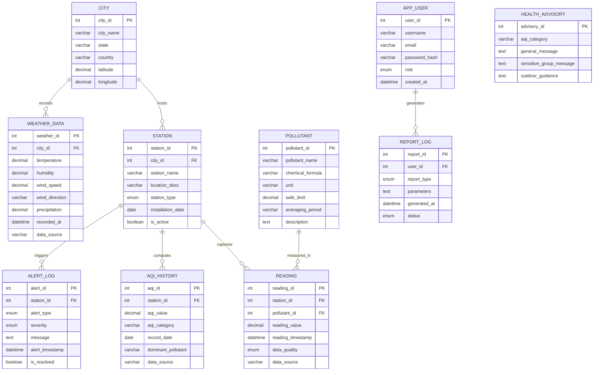

# Entity-Relationship (ER) Documentation
## AQI Monitoring & Prediction System
**Team: Big Coders &bull; Group: 3Q15**  
**Members: Aryan Sharma, Aniket Raj, Chirag Lamba**

---

## 1. Mermaid ER Diagram

---

## 2. Entity Dictionary & Cardinalities

| Relationship | Cardinality | Participation | Description |
|---|---|---|---|
| `city` &rarr; `station` | 1 : N | Mandatory (Every station belongs to 1 city) | A geographic city encompasses multiple atmospheric monitoring stations. |
| `station` &rarr; `reading` | 1 : N | Mandatory (Every reading belongs to 1 station) | Stations continuously log pollutant sensor observations. |
| `pollutant` &rarr; `reading` | 1 : N | Mandatory (Every reading identifies 1 pollutant) | 8 CPCB parameters (`PM2.5`, `PM10`, `NO2`, `SO2`, `CO`, `O3`, `NH3`, `Pb`). |
| `station` &rarr; `aqi_history` | 1 : N | Optional | Daily consolidated station-level AQI calculations. |
| `station` &rarr; `alert_log` | 1 : N | Optional | Automated threshold alerts and sensor anomaly notifications. |
| `city` &rarr; `weather_data` | 1 : N | Optional | Local ambient conditions (temperature, humidity, wind, rain). |
| `app_user` &rarr; `report_log` | 1 : N | Mandatory | User-initiated audit trail of generated reports. |

---

## 3. Referential Constraints & Integrity Rules
- **Foreign Keys**: Configured with `ON DELETE CASCADE ON UPDATE CASCADE` to guarantee strict referential integrity.
- **Unique Constraints**:
  - `city(city_name, state)`: Disallows duplicate city records within the same state.
  - `station(station_name)`: Enforces distinct station nomenclature.
  - `pollutant(chemical_formula)`: Ensures standardized chemical identifiers.
  - `aqi_history(station_id, record_date)`: Strictly permits exactly one consolidated AQI entry per station per calendar day.
  - `app_user(username)` & `app_user(email)`: Enforces distinct user identities.
  - `health_advisory(aqi_category)`: Enforces single advisory set per CPCB category.

